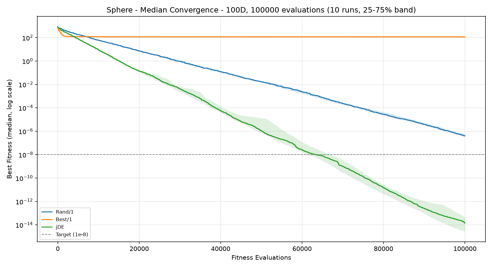
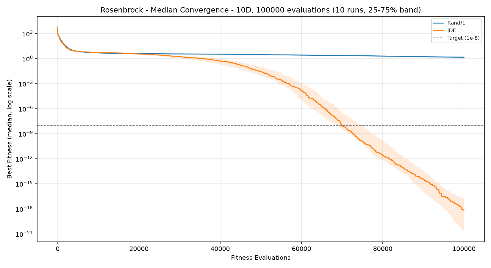

# Differential Evolution
**Rand/1, Best/1 and jDE on Sphere, Rosenbrock and Schwefel**

---

## 1. Objective

The goal of this project is to implement three versions of differential evolution (DE) and to show their convergence on real-valued test functions:

- **Rand/1** - `v_i = x_r1 + F(x_r2 - x_r3)`.
- **Best/1** - `v_i = x_best + F(x_r1 - x_r2)`.
- **jDE** - Rand/1 mutation with self-adaptive `F` and `CR`.

The algorithms are tested on three minimization problems. All of them have a global minimum of `f = 0`.

| Function | Domain | Character |
|---|:---:|---|
| Sphere | [-5.12, 5.12] | Unimodal, optimum at 0 |
| Rosenbrock | [-2.048, 2.048] | Narrow curved valley, optimum at (1, ..., 1) |
| Schwefel | [-500, 500] | Multimodal, separable, optimum near the domain edge |

## 2. Algorithm Design

Each individual is a vector of `D` real numbers.

The algorithm follows these steps:

1. **Initialization** - generate a random population inside the domain.
2. **Mutation** - create a noise vector `v_i` for the active individual. The indexes `r1, r2, r3` are distinct and differ from `i`.
3. **Crossover** - create a trial vector: each parameter comes from `v_i` with probability `CR`, otherwise from the active individual. At least one parameter must come from `v_i`.
4. **Repair** - clip parameters that left the domain to the nearest bound.
5. **Selection** - the better of the trial vector and the active individual (a tie goes to the trial) takes the place in the new population.
6. **Replacement** - when the generation is finished, the new population replaces the old one. `x_best` stays the same during a generation. Repeat until the evaluation budget is exhausted.

**jDE** gives every individual its own `F_i` and `CR_i`. Before mutation, `F_i` is replaced by a random value from [0.1, 0.9] with probability `tau1`, and `CR_i` by a random value from [0, 1] with probability `tau2`. The new values survive only if the trial vector wins the selection.

## 3. Experimental Setup

Experiments are performed for three dimensions, with **10 independent runs** per configuration.

| Dimension | Fitness Evaluations | Generations | Runs |
|:---:|---:|---:|:---:|
| 10D | 10,000 | 200 | 10 |
| 30D | 30,000 | 600 | 10 |
| 100D | 100,000 | 2,000 | 10 |

The budget is `1000 * D` evaluations and the population size is fixed at 50, so the number of generations grows with the dimension. In 10D the algorithm has only 200 generations, which is short for DE. This is why results in 10D are often not better than in 100D (for example Rand/1 on Sphere): the 100D problem is harder, but the algorithm also gets 10 times more generations.

### Parameters

The values of `F`, `CR`, `tau1` and `tau2` are the recommended values from the assignment.

| Parameter | Rand/1 | Best/1 | jDE |
|---|:---:|:---:|:---:|
| Population size | 50 | 50 | 50 |
| F | 0.5 | 0.5 | 0.5 at start, range 0.1-0.9 |
| CR | 0.8 | 0.8 | 0.9 at start, range 0-1 |
| tau1, tau2 | - | - | 0.1 |
| Mutation | Rand/1 | Best/1 | Rand/1 |

A run counts as optimal when it reaches `f <= 1e-8`.

## 4. Experimental Results

### 4.1 Performance

The following statistics represent the final best fitness values obtained across 10 runs (lower is better).

| Problem | Dimension | Version | Best | Worst | Mean | Median | Std. Dev. | Optimal Runs |
|---|---|---|---:|---:|---:|---:|---:|:---:|
| Sphere | 10D | Rand/1 | 2.75e-08 | 2.53e-07 | 1.05e-07 | 8.50e-08 | 7.74e-08 | 0/10 |
| Sphere | 10D | Best/1 | 3.15e-34 | 1.18e-04 | 1.90e-05 | 2.17e-10 | 3.83e-05 | 7/10 |
| Sphere | 10D | jDE | 1.59e-09 | 1.81e-08 | 7.89e-09 | 7.20e-09 | 5.08e-09 | 7/10 |
| Sphere | 30D | Rand/1 | 2.59e-07 | 2.91e-06 | 1.15e-06 | 8.18e-07 | 8.27e-07 | 0/10 |
| Sphere | 30D | Best/1 | 0.68 | 6.37 | 2.79 | 2.30 | 1.69 | 0/10 |
| Sphere | 30D | jDE | 2.39e-12 | 5.61e-11 | 1.52e-11 | 9.56e-12 | 1.62e-11 | 10/10 |
| Sphere | 100D | Rand/1 | 1.86e-07 | 6.63e-07 | 4.45e-07 | 4.07e-07 | 1.66e-07 | 0/10 |
| Sphere | 100D | Best/1 | 95.67 | 161.13 | 122.02 | 116.44 | 22.78 | 0/10 |
| Sphere | 100D | jDE | 1.17e-15 | 2.74e-12 | 3.17e-13 | 1.46e-14 | 8.55e-13 | 10/10 |
| Rosenbrock | 10D | Rand/1 | 2.63 | 5.78 | 4.80 | 4.85 | 0.90 | 0/10 |
| Rosenbrock | 10D | Best/1 | 3.18 | 55.65 | 11.63 | 6.75 | 15.69 | 0/10 |
| Rosenbrock | 10D | jDE | 2.87 | 6.64 | 5.33 | 5.63 | 1.09 | 0/10 |
| Rosenbrock | 30D | Rand/1 | 24.27 | 26.28 | 25.30 | 25.27 | 0.63 | 0/10 |
| Rosenbrock | 30D | Best/1 | 64.07 | 287.51 | 152.69 | 151.23 | 71.23 | 0/10 |
| Rosenbrock | 30D | jDE | 23.77 | 79.46 | 29.97 | 24.81 | 17.40 | 0/10 |
| Rosenbrock | 100D | Rand/1 | 92.75 | 96.44 | 95.48 | 95.83 | 1.12 | 0/10 |
| Rosenbrock | 100D | Best/1 | 1872.32 | 3461.35 | 2538.19 | 2475.27 | 559.59 | 0/10 |
| Rosenbrock | 100D | jDE | 92.12 | 98.47 | 94.42 | 94.02 | 1.99 | 0/10 |
| Schwefel | 10D | Rand/1 | 1038.52 | 1535.22 | 1305.77 | 1338.80 | 155.51 | 0/10 |
| Schwefel | 10D | Best/1 | 473.75 | 1444.05 | 972.88 | 958.14 | 312.31 | 0/10 |
| Schwefel | 10D | jDE | 0.21 | 177.46 | 56.90 | 41.13 | 55.12 | 0/10 |
| Schwefel | 30D | Rand/1 | 6791.04 | 7499.63 | 7133.31 | 7135.91 | 241.14 | 0/10 |
| Schwefel | 30D | Best/1 | 2926.85 | 4877.32 | 4149.19 | 4162.91 | 584.46 | 0/10 |
| Schwefel | 30D | jDE | 123.10 | 487.94 | 287.71 | 254.25 | 117.31 | 0/10 |
| Schwefel | 100D | Rand/1 | 28091.62 | 30704.65 | 29463.52 | 29607.93 | 825.69 | 0/10 |
| Schwefel | 100D | Best/1 | 18965.29 | 22464.16 | 20773.46 | 20547.83 | 1231.70 | 0/10 |
| Schwefel | 100D | jDE | 610.50 | 2790.13 | 1677.54 | 1688.45 | 732.01 | 0/10 |

*Standard deviation is calculated using the sample standard deviation.*

### 4.2 Best Versions

The best version was selected primarily by median fitness, followed by the number of optimal runs and convergence speed. The median is used because a single bad run can move the mean by orders of magnitude (Sphere 10D, Best/1: mean 1.90e-05, median 2.17e-10).

| Problem | Dimension | Best Version | Median Fitness | Optimal Runs |
|---|---|---|---:|:---:|
| Sphere | 10D | Best/1 | 2.17e-10 | 7/10 |
| Sphere | 30D | jDE | 9.56e-12 | 10/10 |
| Sphere | 100D | jDE | 1.46e-14 | 10/10 |
| Rosenbrock | 10D | Rand/1 | 4.85 | 0/10 |
| Rosenbrock | 30D | jDE | 24.81 | 0/10 |
| Rosenbrock | 100D | jDE | 94.02 | 0/10 |
| Schwefel | 10D | jDE | 41.13 | 0/10 |
| Schwefel | 30D | jDE | 254.25 | 0/10 |
| Schwefel | 100D | jDE | 1688.45 | 0/10 |

### 4.3 Convergence Analysis

The convergence graphs show the **median best-so-far fitness over 10 runs** as a function of the number of fitness evaluations, on a logarithmic scale. The shaded band covers the 25th to 75th percentile of the runs. The horizontal dashed line represents the target `f = 1e-8`.

The median is used instead of the mean because on a logarithmic scale the mean follows the worst run. For example, at 40,000 evaluations on Sphere 100D, one jDE run had `f = 5.25e-02` while the other nine were between 1.9e-05 and 1.2e-03. The mean (5.42e-03) was 100 times higher than the median (5.55e-05), and the drop of that one run looked like a step in the averaged curve.

Example of convergence on Sphere in 100D:

### 4.4 Control Experiment: Rosenbrock 10D with a Larger Budget

No version solved Rosenbrock in the main experiment. To find out whether the budget is the reason, Rand/1 and jDE were run again in 10D with **10 times more evaluations** (100,000, i.e. 2,000 generations). The population size stays at 50 and the seeds are the same, so the runs start from the same populations as before.

| Version | Evaluations | Best | Worst | Mean | Median | Optimal Runs |
|---|---:|---:|---:|---:|---:|:---:|
| Rand/1 | 10,000 | 2.63 | 5.78 | 4.80 | 4.85 | 0/10 |
| Rand/1 | 100,000 | 0.43 | 4.36 | 1.71 | 1.44 | 0/10 |
| jDE | 10,000 | 2.87 | 6.64 | 5.33 | 5.63 | 0/10 |
| jDE | 100,000 | 9.08e-24 | 9.82e-15 | 9.88e-16 | 7.43e-19 | 10/10 |

Complete statistics for all 29 experimental configurations are available in [`de_results/summary.csv`](de_results/summary.csv).

## 5. Discussion

**Sphere**

All three versions work, but they behave differently. Rand/1 improves steadily and ends at about 1e-7 in every dimension, just above the target. jDE follows the same mutation with better results and reaches the target in 10/10 runs in 30D and 100D.

Best/1 falls fastest at the start, but in 30D and 100D its curve soon becomes flat (median 2.30 and 116.44). All offspring are built around one individual, so the population most likely loses its diversity, the difference vectors shrink, and the search stops long before the optimum. In 10D Best/1 has the best median (2.17e-10), but also the widest spread: the best run reached 3.15e-34, the worst 1.18e-04.

**Rosenbrock**

No version reached the target in the main experiment. Rand/1 and jDE end close to each other, and their differences are about the size of the run-to-run spread, so neither can be called better from 10 runs. Best/1 stalls early again and is clearly the worst in 30D and 100D.

The control experiment shows that the main reason is the budget. With 10 times more evaluations, jDE reached the target in 10/10 runs, crossing `f = 1e-8` after 70,735 evaluations on average. Rand/1 also improved (median 4.85 → 1.44), but much more slowly, and did not reach the target in any run. Rosenbrock in 10D has a local minimum with `f ≈ 3.99` near the point (-1, 1, ..., 1). The median of Rand/1 fell well below this value, so most runs were not trapped there. They were still moving slowly along the curved valley when the budget ran out.

**Schwefel**

jDE is better than the other two by an order of magnitude in every dimension, although it did not reach the target within the budget. Schwefel is separable, so a low `CR` that changes only a few parameters at once is probably useful here, and jDE can find such values itself, while Rand/1 and Best/1 keep `CR = 0.8`. This explanation was not tested by a separate experiment. Best/1 is better than Rand/1 here, but only because it converges faster: in the 10D graph it stops improving early, while the curve of jDE keeps falling until the end of the budget.

## 6. Conclusion

The experiments demonstrate that all three versions of DE are functional and converge on the tested functions.

Among the tested versions, **jDE** gave the best median in 7 of 9 cases and was never clearly worse than Rand/1, so it is the safest choice. Parameters do not have to be tuned by hand, because the algorithm adapts them during the run.

**Rand/1** is slower but reliable, with a very small spread on Sphere and Rosenbrock. **Best/1** converges fastest at the start but stalls early, especially in higher dimensions.

Rosenbrock was not solved within `1000 * D` evaluations, but the control experiment shows that this is a matter of budget: with 10 times more evaluations, jDE solved Rosenbrock 10D in all 10 runs. More independent runs and a statistical test would be needed to confirm the smaller differences between Rand/1 and jDE.

---

## 7. Convergence Graphs

The following graphs compare the median convergence of all three versions over 10 runs, with the 25-75% band.

### Sphere

- [Sphere – 10D](de_results/Sphere_10D.png)
- [Sphere – 30D](de_results/Sphere_30D.png)
- [Sphere – 100D](de_results/Sphere_100D.png)

### Rosenbrock

- [Rosenbrock – 10D](de_results/Rosenbrock_10D.png)
- [Rosenbrock – 30D](de_results/Rosenbrock_30D.png)
- [Rosenbrock – 100D](de_results/Rosenbrock_100D.png)
- [Rosenbrock – 10D, control with 100,000 evaluations](de_results/Rosenbrock_10D_control.png)

### Schwefel

- [Schwefel – 10D](de_results/Schwefel_10D.png)
- [Schwefel – 30D](de_results/Schwefel_30D.png)
- [Schwefel – 100D](de_results/Schwefel_100D.png)
